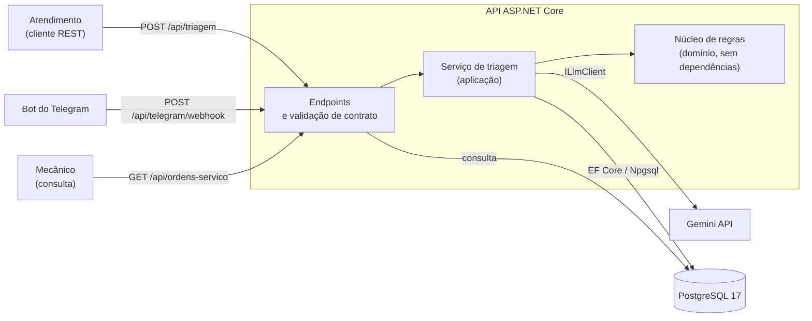
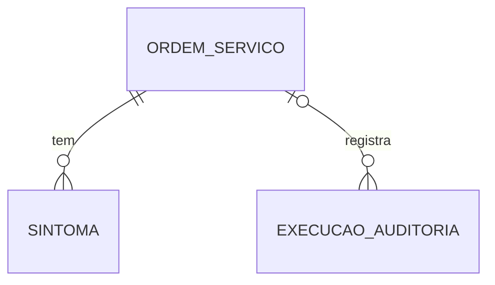
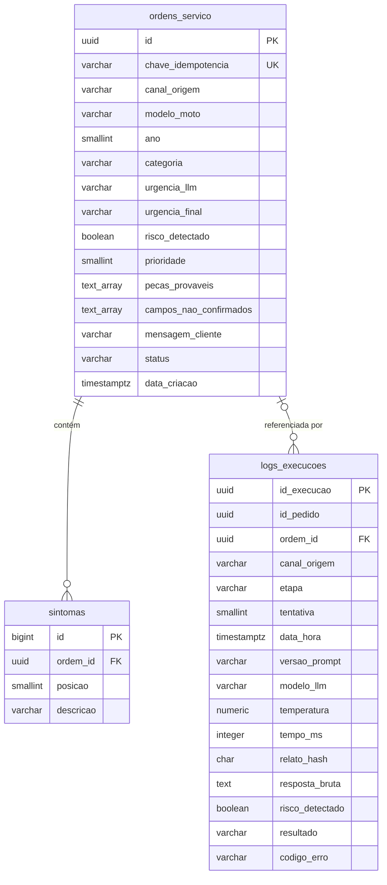
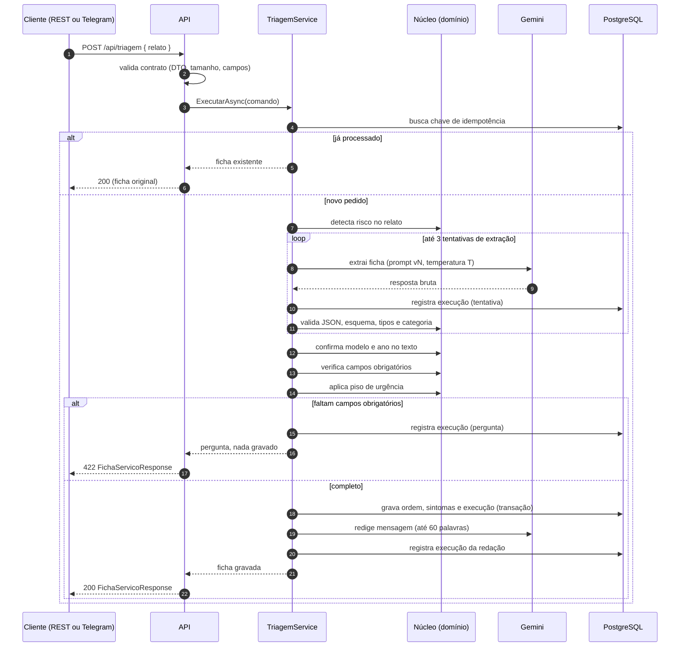

# 06 — Arquitetura da solução e modelo de dados

- **Versão:** 2.1
- **Data da última mudança:** 05/11/2026
- **Substitui:** versão 1.0, que descrevia a arquitetura em n8n e planilha ou CSV

---

## 1. Visão geral

O sistema separa duas responsabilidades. O **Gemini** interpreta o texto livre do relato e
propõe uma ficha. O **código C#** valida essa proposta, aplica as regras de negócio e decide o
que acontece com ela. O modelo nunca grava dados, nunca decide se uma ficha está completa e
nunca rebaixa a urgência.

> O Gemini interpreta o texto. O código garante as regras. O banco reforça as regras.

| Componente | Responsabilidade | Tipo de decisão |
| ---------- | ---------------- | --------------- |
| Gemini (API HTTP) | Extrai campos, classifica categoria e urgência, sugere peças e redige a mensagem ao cliente | Probabilística |
| Núcleo de regras (C#, domínio) | Valida esquema, tipos, categorias, campos obrigatórios e presença dos dados no texto; aplica a regra de risco | Determinística |
| Serviço de aplicação (C#) | Orquestra as etapas, a repetição controlada, a idempotência e a gravação | Determinística |
| API ASP.NET Core | Recebe as requisições, valida o contrato, traduz resultados em códigos HTTP | Determinística |
| PostgreSQL | Guarda ordens, sintomas e registros de execução; aplica restrições de integridade | Armazenamento e restrição |

O sistema recebe dois canais de entrada (REST e Telegram), que compartilham o mesmo núcleo.
Os testes de avaliação também chamam esse núcleo, então o que o conjunto de teste mede é o que
roda no uso real.



---

## 2. Comportamento do modelo

Esta seção descreve o que se pode esperar do Gemini e o que o código precisa compensar.

### 2.1 Saída guiada por esquema

A chamada à API do Gemini pede resposta em JSON conforme um esquema, por meio da
configuração de saída estruturada do próprio endpoint de geração. O nome exato do campo
depende da versão da API e é confirmado na primeira chamada de teste (fase de implementação).
O esquema reduz respostas malformadas, mas não as elimina e não garante que o conteúdo esteja
certo. Por isso, a validação em código é a barreira real: determinística, testável e
independente da obediência do modelo.

### 2.2 Dados ausentes retornam `null`

O prompt manda o modelo usar `null` quando modelo ou ano não estiverem no relato. Ainda assim,
o código faz uma segunda conferência: modelo e ano só são mantidos se aparecerem no texto
(seção 6.4, `ConfirmadorDados`). Se não aparecerem, o campo vira `null` e entra em
`camposNaoConfirmados`.

### 2.3 Variação entre execuções

Mesmo com temperatura baixa, o mesmo relato pode produzir categorias diferentes em execuções
diferentes. O projeto trata isso de três formas:

- **Medição, não suposição.** Cada caso do gabarito roda três vezes. A métrica de consistência
  mede quantos casos mantêm a mesma categoria nas três execuções.
- **Repetição só para formato.** Saída fora do esquema ou com categoria inválida gera nova
  chamada, até duas vezes. Categoria diferente, mas válida, não gera repetição: é erro de
  acerto, medido pelo gabarito.
- **Registro integral.** Cada chamada gera um registro em `logs_execucoes` com versão do prompt,
  modelo, temperatura, tempo e resposta bruta (RF10).

### 2.4 Limites da API

O nível gratuito do Gemini aplica limites por minuto (RPM), por tokens por minuto (TPM) e por
dia (RPD). Os limites são por projeto. Quando um limite é atingido, a API responde com erro de
cota (429), que é tratado na seção 7.2.

Para a avaliação, a rodada de 24 casos com 3 execuções cada, ou 72 chamadas, roda em lotes
com pausa.

---

## 3. Modelo conceitual

O modelo conceitual descreve as entidades do domínio e como elas se relacionam, sem detalhes
de tipo ou de armazenamento.



| Entidade | Papel | Atributos principais | Relacionamentos |
| -------- | ----- | -------------------- | --------------- |
| **OrdemServico** | Ficha de serviço gravada depois das validações | Identificador, chave de idempotência, canal de origem, modelo da moto, ano, categoria, urgência do LLM, urgência final, risco detectado, peças prováveis, campos não confirmados, mensagem ao cliente, status, data de criação | Tem zero ou mais Sintomas. Pode ser referenciada por zero ou mais ExecucaoAuditoria |
| **Sintoma** | Um sintoma citado no relato | Posição na lista, descrição | Pertence a exatamente uma OrdemServico |
| **ExecucaoAuditoria** | Registro de cada chamada ao LLM (rastreabilidade, RF10) | Identificador da execução, identificador do pedido, etapa, tentativa, versão do prompt, modelo, temperatura, tempo, resposta bruta, resultado, código de erro, hash do relato | Pode estar ligada a zero ou uma OrdemServico |

**Por que a execução não contém a ficha inteira.** A ficha é a decisão final do sistema. A
execução é o fato de uma chamada: o que foi pedido, o que o modelo respondeu e quanto tempo
levou. Separar as duas coisas permite comparar versões de prompt sem alterar a ficha.

**Por que a execução tem `idPedido`.** Um pedido pode gerar até três execuções de extração e
uma de redação. O `idPedido` agrupa todas elas.

---

## 4. Modelo relacional (PostgreSQL)

### 4.1 Domínios fixos

As oito categorias canônicas são mantidas em uma única lista no código
(`Categorias.Canonicas`). A restrição `CHECK` do banco usa a mesma lista. Um teste de integração
insere cada categoria canônica e confirma que um valor fora da lista é recusado pelo banco.

| Domínio | Valores |
| ------- | ------- |
| Categoria | `corrente e relação`, `freios`, `suspensão`, `motor e lubrificação`, `elétrica e bateria`, `pneus e rodas`, `revisão periódica`, `outro ou não identificado` |
| Urgência | `baixa`, `media`, `alta` |
| Status da ordem | `aberta`, `em_execucao`, `concluida`, `cancelada` |
| Canal de origem | `rest`, `telegram` |
| Etapa da execução | `extracao`, `redacao_mensagem` |
| Resultado da execução | `gravada`, `pergunta`, `falha_formato`, `falha_api`, `mensagem_gerada` |

### 4.2 Tabela `ordens_servico`

| Coluna | Tipo | Nulo | Padrão | Descrição |
| ------ | ---- | ---- | ------ | --------- |
| `id` | UUID | Não | `gen_random_uuid()` | Chave primária |
| `chave_idempotencia` | VARCHAR(100) | Não | — | `Idempotency-Key` do cliente, `telegram:{update_id}`, ou `rest:{idPedido}` quando o cliente não envia chave. Única |
| `canal_origem` | VARCHAR(20) | Não | — | `rest` ou `telegram` |
| `modelo_moto` | VARCHAR(120) | Sim | — | Modelo como redigido no relato (só se confirmado no texto) |
| `ano` | SMALLINT | Sim | — | Ano de fabricação, se confirmado no texto |
| `categoria` | VARCHAR(40) | Não | — | Uma das 8 categorias canônicas |
| `urgencia_llm` | VARCHAR(10) | Não | — | Urgência proposta pelo Gemini |
| `urgencia_final` | VARCHAR(10) | Não | — | Urgência após o piso de risco |
| `risco_detectado` | BOOLEAN | Não | — | `true` quando o relato contém palavra de risco |
| `prioridade` | SMALLINT | Não | Calculada | `3` alta, `2` média, `1` baixa. Coluna gerada, usada para ordenar a fila |
| `pecas_provaveis` | TEXT[] | Não | `'{}'` | Peças sugeridas pelo Gemini |
| `campos_nao_confirmados` | TEXT[] | Não | `'{}'` | Campos que o Gemini informou e não apareceram no relato |
| `mensagem_cliente` | VARCHAR(1000) | Sim | — | Mensagem ao cliente. O limite de negócio é de 60 palavras, validado no código; o limite do banco é só uma proteção |
| `status` | VARCHAR(20) | Não | `'aberta'` | Status da ordem |
| `data_criacao` | TIMESTAMPTZ | Não | `now()` | Momento da gravação, em UTC |

**DDL**

```sql
CREATE TABLE ordens_servico (
    id                      UUID          PRIMARY KEY DEFAULT gen_random_uuid(),
    chave_idempotencia      VARCHAR(100)  NOT NULL,
    canal_origem            VARCHAR(20)   NOT NULL,
    modelo_moto             VARCHAR(120),
    ano                     SMALLINT,
    categoria               VARCHAR(40)   NOT NULL,
    urgencia_llm            VARCHAR(10)   NOT NULL,
    urgencia_final          VARCHAR(10)   NOT NULL,
    risco_detectado         BOOLEAN       NOT NULL,
    prioridade              SMALLINT      GENERATED ALWAYS AS (
                                CASE urgencia_final
                                    WHEN 'alta'  THEN 3
                                    WHEN 'media' THEN 2
                                    ELSE 1
                                END
                            ) STORED,
    pecas_provaveis         TEXT[]        NOT NULL DEFAULT '{}',
    campos_nao_confirmados  TEXT[]        NOT NULL DEFAULT '{}',
    mensagem_cliente        VARCHAR(1000),
    status                  VARCHAR(20)   NOT NULL DEFAULT 'aberta',
    data_criacao            TIMESTAMPTZ   NOT NULL DEFAULT now(),

    CONSTRAINT uq_ordens_chave_idempotencia UNIQUE (chave_idempotencia),
    CONSTRAINT ck_ordens_canal CHECK (canal_origem IN ('rest', 'telegram')),
    CONSTRAINT ck_ordens_ano CHECK (ano IS NULL OR ano BETWEEN 1900 AND 2100),
    CONSTRAINT ck_ordens_categoria CHECK (categoria IN (
        'corrente e relação', 'freios', 'suspensão', 'motor e lubrificação',
        'elétrica e bateria', 'pneus e rodas', 'revisão periódica',
        'outro ou não identificado'
    )),
    CONSTRAINT ck_ordens_urgencia_llm CHECK (urgencia_llm IN ('baixa', 'media', 'alta')),
    CONSTRAINT ck_ordens_urgencia_final CHECK (urgencia_final IN ('baixa', 'media', 'alta')),
    -- A urgência final é a do LLM ou alta. Nunca é rebaixada.
    CONSTRAINT ck_ordens_piso_urgencia CHECK (
        urgencia_final = urgencia_llm OR urgencia_final = 'alta'
    ),
    -- Relato com palavra de risco é sempre alta.
    CONSTRAINT ck_ordens_risco CHECK (NOT risco_detectado OR urgencia_final = 'alta'),
    CONSTRAINT ck_ordens_status CHECK (status IN ('aberta', 'em_execucao', 'concluida', 'cancelada'))
);

CREATE INDEX ix_ordens_fila
    ON ordens_servico (status, prioridade DESC, data_criacao ASC);

CREATE INDEX ix_ordens_categoria_status
    ON ordens_servico (categoria, status);
```

**Por que as duas restrições de urgência.** A regra de piso existe em código (domínio), e o
banco a repete como segunda barreira. Se um futuro caminho de código gravar uma urgência
rebaixada, o banco recusa a gravação. O teste de integração tenta gravar essa combinação
inválida e espera a recusa.

**Por que `prioridade` é coluna gerada.** Ordenar por texto (`alta`, `baixa`, `media`) daria a
ordem alfabética, não a de risco. A coluna numérica gerada resolve isso sem lógica na consulta,
e o índice `ix_ordens_fila` cobre a consulta do mecânico (UC02).

### 4.3 Tabela `sintomas`

| Coluna | Tipo | Nulo | Descrição |
| ------ | ---- | ---- | --------- |
| `id` | BIGINT (identidade) | Não | Chave primária |
| `ordem_id` | UUID | Não | Referência a `ordens_servico.id` |
| `posicao` | SMALLINT | Não | Ordem do sintoma na lista, a partir de 1 |
| `descricao` | VARCHAR(300) | Não | Texto do sintoma |

**DDL**

```sql
CREATE TABLE sintomas (
    id          BIGINT        GENERATED ALWAYS AS IDENTITY PRIMARY KEY,
    ordem_id    UUID          NOT NULL REFERENCES ordens_servico (id) ON DELETE CASCADE,
    posicao     SMALLINT      NOT NULL,
    descricao   VARCHAR(300)  NOT NULL,

    CONSTRAINT uq_sintomas_ordem_posicao UNIQUE (ordem_id, posicao),
    CONSTRAINT ck_sintomas_posicao CHECK (posicao >= 1),
    CONSTRAINT ck_sintomas_descricao CHECK (char_length(btrim(descricao)) > 0)
);
```

A restrição `UNIQUE (ordem_id, posicao)` também cria um índice que atende à busca de sintomas
por ordem. Por isso não há índice separado para `ordem_id`.

### 4.4 Tabela `logs_execucoes`

| Coluna | Tipo | Nulo | Descrição |
| ------ | ---- | ---- | --------- |
| `id_execucao` | UUID | Não | Chave primária da chamada |
| `id_pedido` | UUID | Não | Agrupa as execuções de um mesmo pedido |
| `ordem_id` | UUID | Sim | Ordem gerada, quando houver. `ON DELETE SET NULL` |
| `canal_origem` | VARCHAR(20) | Não | `rest` ou `telegram` |
| `etapa` | VARCHAR(20) | Não | `extracao` ou `redacao_mensagem` |
| `tentativa` | SMALLINT | Não | 1 a 3 |
| `data_hora` | TIMESTAMPTZ | Não | Momento da chamada, em UTC |
| `versao_prompt` | VARCHAR(20) | Não | `v1`, `v2` etc., conforme `prompts/` |
| `modelo_llm` | VARCHAR(60) | Não | Nome do modelo usado, conforme a configuração |
| `temperatura` | NUMERIC(3,2) | Não | Temperatura usada na chamada |
| `tempo_ms` | INTEGER | Não | Tempo total da chamada, em milissegundos |
| `tokens_entrada` | INTEGER | Sim | Tokens enviados, quando informados pela API |
| `tokens_saida` | INTEGER | Sim | Tokens recebidos, quando informados pela API |
| `relato_hash` | CHAR(64) | Não | HMAC-SHA256 do relato, em hexadecimal, com chave secreta que não fica no banco. O texto não é guardado (P3) |
| `resposta_bruta` | TEXT | Sim | Saída do Gemini antes de qualquer validação. Expurgada após o prazo de `Privacidade:RetencaoRespostaBrutaDias` (valor provisório: 30 dias) |
| `risco_detectado` | BOOLEAN | Não | Resultado da regra de risco para este relato |
| `resultado` | VARCHAR(20) | Não | Resultado da chamada (ver 4.1) |
| `codigo_erro` | VARCHAR(60) | Sim | Motivo técnico, como `json_invalido`, `categoria_invalida`, `http_429`, `http_401`, `timeout`, `banco_indisponivel` |

**DDL**

```sql
CREATE TABLE logs_execucoes (
    id_execucao      UUID          PRIMARY KEY DEFAULT gen_random_uuid(),
    id_pedido        UUID          NOT NULL,
    ordem_id         UUID          REFERENCES ordens_servico (id) ON DELETE SET NULL,
    canal_origem     VARCHAR(20)   NOT NULL,
    etapa            VARCHAR(20)   NOT NULL,
    tentativa        SMALLINT      NOT NULL,
    data_hora        TIMESTAMPTZ   NOT NULL DEFAULT now(),
    versao_prompt    VARCHAR(20)   NOT NULL,
    modelo_llm       VARCHAR(60)   NOT NULL,
    temperatura      NUMERIC(3,2)  NOT NULL,
    tempo_ms         INTEGER       NOT NULL,
    tokens_entrada   INTEGER,
    tokens_saida     INTEGER,
    relato_hash      CHAR(64)      NOT NULL,   -- HMAC-SHA256 em hex; chave fora do banco
    resposta_bruta   TEXT,
    risco_detectado  BOOLEAN       NOT NULL,
    resultado        VARCHAR(20)   NOT NULL,
    codigo_erro      VARCHAR(60),

    CONSTRAINT ck_logs_canal CHECK (canal_origem IN ('rest', 'telegram')),
    CONSTRAINT ck_logs_etapa CHECK (etapa IN ('extracao', 'redacao_mensagem')),
    CONSTRAINT ck_logs_tentativa CHECK (tentativa BETWEEN 1 AND 3),
    CONSTRAINT ck_logs_temperatura CHECK (temperatura BETWEEN 0 AND 2),
    CONSTRAINT ck_logs_tempo CHECK (tempo_ms >= 0),
    CONSTRAINT ck_logs_resultado CHECK (resultado IN (
        'gravada', 'pergunta', 'falha_formato', 'falha_api', 'mensagem_gerada'
    )),
    -- Redação de mensagem só pode terminar em mensagem gerada ou em falha.
    CONSTRAINT ck_logs_resultado_etapa CHECK (
        etapa <> 'redacao_mensagem'
        OR resultado IN ('mensagem_gerada', 'falha_formato', 'falha_api')
    ),
    -- Só existe resultado "gravada" quando há ordem vinculada.
    CONSTRAINT ck_logs_gravada_com_ordem CHECK (
        resultado <> 'gravada' OR ordem_id IS NOT NULL
    ),
    CONSTRAINT ck_logs_hash CHECK (relato_hash ~ '^[0-9a-f]{64}$')
);

CREATE INDEX ix_logs_id_pedido ON logs_execucoes (id_pedido);
CREATE INDEX ix_logs_ordem ON logs_execucoes (ordem_id) WHERE ordem_id IS NOT NULL;
CREATE INDEX ix_logs_metricas ON logs_execucoes (versao_prompt, etapa, resultado);
CREATE INDEX ix_logs_data_hora ON logs_execucoes (data_hora);
```

**Por que HMAC e não SHA-256 puro.** O relato é texto livre digitado no balcão ou no chat, e pode
conter nome ou telefone por engano. Relatos de oficina são curtos e repetitivos, então um SHA-256
simples pode ser verificado por dicionário: quem tiver a tabela testa textos candidatos e confirma
o relato. Com HMAC-SHA256 e uma chave secreta fora do banco, essa verificação exige a chave. O
registro ainda permite reconhecer dois pedidos com o mesmo relato (mesmo HMAC), sem guardar o
conteúdo (RNF02).

**Limites da proteção.** Enquanto a chave existir, quem a tiver e tiver o relato consegue confirmar
o vínculo. Por isso a chave fica em user-secrets ou variável de ambiente, nunca no banco. Trocar a
chave impede a comparação com registros antigos, o que deve ser registrado como decisão. A
`resposta_bruta` pode repetir trechos do relato. Ela não recebe HMAC e tem prazo de retenção.

Os textos usados na avaliação ficam no gabarito, que é de dados fictícios. A adoção segue o P3 da
especificação.

**Consultas de métricas.** O índice `ix_logs_metricas` atende ao relatório por versão do
prompt. Exemplo: taxa de `falha_formato` na extração da versão `v1`.

```sql
SELECT versao_prompt,
       COUNT(*) FILTER (WHERE resultado = 'falha_formato') AS falhas_formato,
       COUNT(*) AS total_execucoes,
       ROUND(AVG(tempo_ms)) AS tempo_medio_ms
FROM logs_execucoes
WHERE etapa = 'extracao'
GROUP BY versao_prompt
ORDER BY versao_prompt;
```

### 4.5 Diagrama relacional



### 4.6 Mapeamento para C# (EF Core)

| Entidade | Classe | Tabela | Observação |
| -------- | ------ | ------ | ---------- |
| OrdemServico | `OrdemServico` | `ordens_servico` | `prioridade` é `HasComputedColumnSql(..., stored: true)`. Nunca escrita pela aplicação |
| Sintoma | `Sintoma` | `sintomas` | Coleção `IReadOnlyList<Sintoma>` na ordem, configurada com `OwnsMany` ou relacionamento |
| ExecucaoAuditoria | `ExecucaoAuditoria` | `logs_execucoes` | Gravada em transação própria, para não perder o registro quando a gravação da ordem falhar |

**Atomicidade.** Ordem, sintomas e o registro de execução de extração são gravados em uma
transação. A execução de redação de mensagem é gravada depois, em outra operação, porque a
falha dela não deve desfazer a ficha (fluxo 11a do UC01).

### 4.7 Armazenamento e migrações

- Os esquemas são criados por migrações do EF Core (`dotnet ef migrations add`), versionadas no
  Git. O SQL acima é a referência; a migração inicial deve gerar exatamente essas estruturas.
- Em desenvolvimento, as migrações são aplicadas na inicialização da API. Em outros ambientes,
  elas são aplicadas por script gerado a partir das migrações.
- O banco usa codificação UTF-8, necessária para os acentos das categorias.

### 4.8 Banco de dados: isolamento e recomendação

**Premissa verificada.** O projeto legado (versão 1.0) não usa PostgreSQL. Ele guardava as fichas em
CSV, em Google Sheets ou em tabela de dados do n8n (seção 3.5 da versão 1.0). Por isso, não existe
hoje um banco legado com o qual a nova API possa compartilhar instância. Se o autor tiver outra
instância com dados, por exemplo de um teste anterior, isso deve ser registrado antes de qualquer
migração.

**Opções avaliadas.**

| Opção | Descrição | Avaliação |
| ----- | --------- | --------- |
| A | Mesmo banco e mesmo schema de outro projeto | Rejeitada. Nomes de tabelas podem colidir, o histórico de migrações é compartilhado e uma migração de um projeto pode afetar o outro |
| B | Mesma instância, schema dedicado `os_triage_api` | Aceitável como último recurso. Isola nomes, mas mantém o mesmo superusuário, as mesmas extensões, o mesmo `search_path` e a mesma unidade de backup |
| C | Mesma instância, banco dedicado `os_triage_api` | Boa opção quando houver servidor compartilhado. Isola permissões, backup e restauração |
| D | Contêiner próprio, banco `os_triage_api` e role `os_triage_app` sem superusuário | **Recomendada** para desenvolvimento, avaliação e portfólio. É o que o `docker-compose.yml` sobe |

**Critérios.** Conflito de nomes; migrações independentes; permissões; backup e restauração
separados; acoplamento entre repositórios; complexidade operacional local.

**Recomendação final: opção D no ambiente local e opção C se houver servidor compartilhado no
futuro.** Os motivos são:

1. Um schema não isola permissões. Qualquer papel com acesso ao banco enxerga todos os schemas.
2. Por padrão, o EF Core guarda o histórico de migrações em `public.__EFMigrationsHistory`. Dois
   projetos no mesmo schema disputam essa tabela, e uma migração de um pode aparecer como aplicada
   ao outro.
3. Um banco dedicado permite `pg_dump` e restauração do projeto inteiro, sem separar objetos.
4. O custo é baixo: o contêiner já faz parte do `docker-compose.yml`.

**Controles da opção D.**

- Role `os_triage_app`, dona do banco `os_triage_api`, sem `SUPERUSER`, `CREATEDB` ou `CREATEROLE`.
- Migrações aplicadas somente pelo repositório da API. Nenhum outro projeto escreve nessas tabelas.
- Cópia de segurança do volume `os_triage_pgdata` antes de qualquer migração destrutiva. Em
  desenvolvimento, a migração deve funcionar em banco limpo (critério da seção 8 do
  [plano de testes](07-Plano-testes-software.md)).
- Senha somente em `.env` e em user-secrets. Nunca em `appsettings.json`.

**Concorrência.** Há um único escritor, que é a própria API. A concorrência entre requisições é
tratada por restrições (`UNIQUE` em `chave_idempotencia`) e pelas transações da seção 7.4. O volume
é baixo: a avaliação gera 72 registros por rodada. Por isso, particionamento e índices além dos da
seção 4 não são necessários na versão 2.0.

### 4.9 Retenção da resposta bruta

A `resposta_bruta` pode repetir trechos do relato. Por isso tem prazo de retenção de 30 dias
(`Privacidade:RetencaoRespostaBrutaDias`, baseline aprovado). O expurgo zera o campo e não apaga a
linha, então o registro continua disponível para as métricas (validade do JSON, tempo e resultado).

```sql
UPDATE logs_execucoes
SET resposta_bruta = NULL
WHERE resposta_bruta IS NOT NULL
  AND data_hora < now() - make_interval(days => @dias);
```

- O expurgo roda uma vez por dia, em um `BackgroundService` da API, com `@dias` vindo da
  configuração.
- Na versão 2.0, uma instrução é suficiente. Se o volume crescer, o expurgo passa a rodar em lotes
  pequenos, para não bloquear a tabela.
- O teste de integração correspondente é o CN20 do [plano de testes](07-Plano-testes-software.md).
- O expurgo não altera `relato_hash` nem os demais campos de rastreio. A comparação de pedidos e as
  métricas continuam válidas.

---

## 5. Decisões de arquitetura

### 5.1 Stack

| Componente | Tecnologia | Função | Custo |
| ---------- | ---------- | ------ | ----- |
| Linguagem e runtime | C# com .NET (versão LTS vigente no início do projeto) | Código da API e dos testes | R$ 0 |
| API | ASP.NET Core (Minimal APIs) | Endpoints, validação de contrato, ProblemDetails, OpenAPI | R$ 0 |
| Acesso a dados | EF Core com Npgsql | Mapeamento, migrações, consultas parametrizadas | R$ 0 |
| Banco | PostgreSQL 17 em Docker | Ordens, sintomas, execuções | R$ 0 |
| Cliente HTTP do LLM | `HttpClient` tipado, com `Microsoft.Extensions.Http.Resilience` | Chamadas ao Gemini, com tempo limite e repetição de erros transitórios | R$ 0 |
| LLM | Gemini API (nível gratuito) | Extração, classificação e redação | R$ 0 no nível gratuito |
| Testes | xUnit, `WebApplicationFactory`, Testcontainers (PostgreSQL) | Unitários, integração e avaliação | R$ 0 |
| Contrato | OpenAPI gerado em tempo de execução; `docs/openapi.yaml` será incorporado com o UC01 | Documentação do contrato | R$ 0 |
| Versionamento | Git e GitHub | Código, migrações, prompts, gabarito | R$ 0 |

### 5.2 Decisões

| Decisão | Escolha | Motivo | Alternativa descartada |
| ------- | ------- | ------ | ---------------------- |
| Plataforma de orquestração | API própria em ASP.NET Core | As regras ficam em código testável, sem depender de nós visuais; o autor já tem experiência com C# e ASP.NET Core | Manter o n8n: duplica as regras em nós e impede testar o núcleo isoladamente |
| Papel do n8n | Sai do caminho de execução. Continua como referência histórica (versão 1.0) | Evita um ponto extra de falha e de configuração | n8n como orquestrador da API |
| Persistência | PostgreSQL com restrições no banco | Restrições reforçam as regras de negócio; suporta arrays e colunas geradas | SQLite (sem tipos fortes nem arrays); planilha ou CSV (sem integridade) |
| Banco de dados | Banco dedicado `os_triage_api`, role própria e contêiner próprio (seção 4.8) | Isola migrações, permissões e backup. O projeto legado não usa PostgreSQL | Schema no banco de outro projeto; instância compartilhada |
| Divisão de papéis | Gemini extrai e classifica; código valida e decide | As regras não dependem do prompt | Deixar o modelo decidir se a ficha está completa |
| Canal do Telegram | Webhook síncrono, com a resposta carregando a mensagem do bot | Simples, sem fila e sem chamada extra à Bot API; atende ao requisito de processamento síncrono | Fila com processamento em segundo plano: mais robusta, mas adiada por aumentar a complexidade da v1 (ver 5.3) |
| Idempotência | Chave única por pedido (`chave_idempotencia`) | Protege contra repetição do cliente e do Telegram | Sem controle, com duplicatas |
| Saída do modelo | JSON com esquema e validação em código | Resposta fora do formato nunca chega à ficha | Aceitar texto livre e interpretar depois |
| Urgência | Gemini mais piso de risco, em código e no banco | Errar uma urgência alta é o erro mais grave | Confiar só no modelo, ou só no banco |
| Dados ausentes | `null`, confirmado no texto | Evita invenção de modelo e ano | Deixar o modelo preencher com estimativas |
| Relato como dado | Relato delimitado no prompt e tratado como dado | Reduz o risco de o texto alterar as regras | Juntar o texto às instruções sem delimitação |
| Dados de execução | HMAC-SHA256 do relato, com chave fora do banco, sem o texto | Privacidade (RNF02); impede verificação por dicionário | SHA-256 simples (verificável por dicionário); texto completo |
| Repetição de chamadas | Biblioteca de resiliência do .NET, só para erros transitórios | Código de repetição padronizado e testado | Laço de repetição manual |
| Unidade de tempo | Milissegundos (`tempo_ms`) | Precisão suficiente para medir o alvo de 15 segundos | Segundos com casas decimais |
| Nomes na API | `camelCase` | Padrão do ASP.NET Core e de clientes JavaScript | `snake_case`, como no n8n |
| Estilo da API | Minimal APIs, com grupos de endpoints por recurso (`TriagemEndpoints`, `ConsultaOrdensEndpoints`). Sem controllers | Menos cerimônia para uma API pequena, com rotas e DTOs explícitos no código | Controllers (MVC): também válidos, mas com mais estrutura do que o escopo pede |

### 5.3 Telegram: processamento síncrono e seu risco

O requisito é receber e tratar as mensagens de forma síncrona (RF14). A decisão tem um custo:
se a triagem demorar mais do que o Telegram espera, o Telegram reenvia o mesmo `update`.

| Mitigação | Efeito |
| --------- | ------ |
| Chave `telegram:{update_id}` | Impede gravação duplicada |
| Tempo limite de 10 segundos por chamada ao Gemini | Limita a espera total |
| No máximo 3 tentativas de extração | Limita a espera total |
| Resposta 200 para `update` repetido | Evita nova mensagem no chat |

**Evolução prevista.** A alternativa é responder 200 de imediato e processar em segundo plano
(fila em PostgreSQL ou serviço de mensagens), enviando a resposta com a Bot API. Essa
alternativa é recomendada se o tempo real medido passar do limite de 15 segundos. A decisão deve
ser revista com o tempo real medido na avaliação (meta de RNF04).

---

## 6. Estrutura da solução e componentes

### 6.1 Projeto único e pastas por responsabilidade

```
os-triage-api/
├── src/
│   └── OsTriageApi/
│       ├── Endpoints/                 # Minimal APIs e tradução para respostas HTTP
│       └── Relatos/
│           ├── Configuracao/          # Opções tipadas e configuração JSON
│           ├── Dtos/                  # Contratos de entrada e saída
│           ├── Modelos/               # Tipos e regras sem dependência de infraestrutura
│           └── Validacao/             # Validações determinísticas da triagem
├── tests/
│   ├── OsTriageApi.Tests.Unit/        # Contrato, categorias, risco e regras da ficha
│   ├── OsTriageApi.Tests.Integration/ # API e PostgreSQL com dependências simuladas
│   ├── OsTriageApi.Tests.Avaliacao/   # 24 casos com Gemini real; somente com opt-in
│   └── casos_teste.csv                # Gabarito congelado (dados fictícios)
├── prompts/
│   ├── v1.md
│   └── v2.md
├── data/                              # Resultados de avaliação; fora do Git
└── docs/
```

**Regra de dependência.** A aplicação permanece em um único projeto, `OsTriageApi`. As pastas
separam responsabilidades: endpoints dependem das regras e dos contratos; regras de domínio não
dependem de HTTP, banco ou Gemini. Os projetos de teste são separados da aplicação. Se o projeto
crescer a ponto de exigir isolamento físico, a divisão em assemblies será uma decisão futura.

### 6.2 Componentes

| Componente | Área do projeto único | Responsabilidade | Requisitos |
| ---------- | --------------------- | --------------- | ---------- |
| `TriagemEndpoints` | `Endpoints` | Minimal API (grupo de endpoints): expõe `POST /api/triagem` e traduz o resultado em código HTTP | RF01, RF05, RF09 |
| `TelegramWebhookHandler` | API (futuro) | Verifica, nesta ordem, o segredo, o chat autorizado (fail closed) e o texto; só então chama o serviço e monta o *webhook reply* | RF14 |
| `ConsultaOrdensEndpoints` | API (futuro) | Minimal API (grupo de endpoints): expõe as consultas de ordens | RF13 |
| `TriagemService` | Aplicação (futuro) | Executa o UC01: repetição controlada, idempotência, regras e gravação | RF02 a RF11 |
| `ILlmClient` | Aplicação (porta futura) | Contrato de extração e de redação, independente do fornecedor | RNF09 |
| `GeminiClient` | Infraestrutura (futuro) | Implementa `ILlmClient` com `HttpClient` tipado | RF02, RF09 |
| `ConsultaOrdensService` | Aplicação (futuro) | Executa o UC02 com filtros e ordenação | RF13 |
| `CategoriasCanonicas` | `Relatos/Modelos` | Lista canônica das 8 categorias e normalização | RF03 |
| `ValidadorSaidaLlm` | `Relatos/Validacao` (futuro) | Valida JSON, esquema, tipos e categoria; descarta chaves desconhecidas | RF02, RF03, RNF03 |
| `RegrasUrgencia` | `Relatos/Validacao` | Procura palavras de risco no relato normalizado | RF04 |
| `ConfirmadorDados` | `Relatos/Validacao` (futuro) | Mantém modelo e ano só se aparecerem no relato | RNF08 |
| `RegrasFicha` | `Relatos/Validacao` | Lista os campos obrigatórios ausentes e aplica o piso de urgência | RF04, RF05 |
| `LimitadorPalavras` | `Relatos/Validacao` (futuro) | Conta palavras da mensagem ao cliente | RF07 |
| `TabelaMarcas` | `Relatos/Modelos` (futuro) | Enriquecimento de marca por tabela estática, depois da confirmação | Seção 6.4 da especificação |
| `OrdemServicoRepository` | Infraestrutura (futuro) | Grava a ordem e os sintomas em transação; consulta a fila | RF06, RF13 |
| `ExecucaoRepository` | Infraestrutura (futuro) | Grava os registros de execução | RF10 |
| `RelatoHasher` | Infraestrutura (futuro) | Calcula o HMAC-SHA256 do relato com a chave de `Privacidade:ChaveHmac` | RNF02, RF10 |
| `RetencaoRespostaBrutaService` | Infraestrutura (futuro) | Expurga `resposta_bruta` após o prazo, em segundo plano (seção 4.9) | RNF02 |

### 6.3 Contratos principais

```csharp
// Application: porta para o modelo. Não conhece HTTP nem o Gemini.
public interface ILlmClient
{
    Task<RespostaLlm> ExtrairFichaAsync(
        string relato, VersaoPrompt versao, CancellationToken ct);

    Task<RespostaLlm> RedigirMensagemAsync(
        FichaValidada ficha, CancellationToken ct);
}

public sealed record RespostaLlm(
    string TextoBruto,
    string Modelo,
    double Temperatura,
    int TempoMs,
    int? TokensEntrada,
    int? TokensSaida);

// Application: falhas que o serviço traduz em resultado de negócio.
public sealed class LlmIndisponivelException(string codigo) : Exception(codigo) { }   // cota, tempo, 5xx
public sealed class LlmAutenticacaoException : Exception { }                           // 401 ou 403
```

### 6.4 Núcleo de regras

As funções abaixo mostram a lógica essencial. São o código de referência que os testes
unitários verificam.

```csharp
// Relatos/Modelos: comparação sem caixa, acento ou espaços repetidos.
public static class Normalizador
{
    public static string Normalizar(string texto) { /* implementação pura e determinística */ }
}

// Relatos/Validacao: linha de base vigente, aplicada ao texto normalizado.
public static class RegrasUrgencia
{
    // freios?, vazamento de oleo, perda de oleo, folga na direcao,
    // pneu (furado|careca), moto desligando sozinha
    public static string? BuscarExpressao(string texto) { /* retorna a expressão ou null */ }
}

// Relatos/Validacao: modelo e problema são obrigatórios; risco somente eleva a urgência.
public static class RegrasFicha
{
    public static ResultadoRegrasFicha Avaliar(FichaExtraida ficha, string relato)
    {
        /* categoria Outro não exige detalhe; urgência final nunca é reduzida */
    }
}
```

Os padrões acima são os da lista inicial. Eles têm lacunas conhecidas, descritas na
especificação (pendência P1, seção 6.6). Os testes unitários documentam essas lacunas e
mudam quando a lista for revisada.

#### Proposta de ampliação (a validar)

Esta proposta não está em vigor. O código acima continua sendo a referência até que a proposta
passe nos testes unitários e na avaliação. Os padrões são somados aos atuais, sem substituí-los.

```csharp
// PROPOSTA: a validar.
new(@"\bvaz\w*\s+(de\s+)?oleo\b", RegexOptions.Compiled),                  // vaza óleo, vazando óleo, vazamento de óleo
new(@"\bpneu\b.{0,30}\b(furad\w*|care(ca|qu)\w*)", RegexOptions.Compiled), // pneu traseiro está careca, pneu tá carequinha
```

Conferência sobre os 24 relatos do gabarito, com os textos normalizados (feita fora do código do
projeto, com um script de verificação): a lista atual detecta 6 dos 9 casos de risco. A proposta
detecta os 9, incluindo CT-06, CT-19 e CT-20. Nenhum caso sem risco do gabarito passa a disparar
alerta.

**Falso positivo conhecido:** "pneu novo, sem careca" dispara a proposta. Antes de adotar, decidir
se o custo é aceitável (um alerta a mais, que pesa na métrica "falsos alertas", com meta de 10%
ou menos no plano de testes) ou se a negação precisa de tratamento próprio.

---

## 7. Pipeline de processamento

### 7.1 Sequência do pedido



### 7.2 Repetição e limites de chamadas

Há dois níveis de repetição, e eles se multiplicam. O quadro abaixo mostra o pior caso.

| Nível | Quem decide | Repetições | Quando |
| ----- | ----------- | ---------- | ------ |
| Formato | `TriagemService` | Até 2 novas tentativas de extração | JSON inválido, esquema incompleto ou categoria fora da lista |
| Transporte | Biblioteca de resiliência | Até 2 novas chamadas HTTP por tentativa | Erro 5xx, tempo esgotado ou 429 |
| Mensagem | `TriagemService` | Até 2 novas redações | Mensagem acima de 60 palavras |

**Caminho feliz:** 2 chamadas HTTP (extração e redação).

**Pior caso:** 9 chamadas HTTP na extração (3 tentativas, cada uma com até 3 chamadas HTTP) e
mais 9 na redação, total de 18. Para limitar o custo em cota, valem estas regras:

- Um 429 com `Retry-After` acima de 10 segundos não é repetido. A API responde 503 na hora.
- O tempo limite de cada chamada é de 10 segundos.
- A avaliação roda em lotes com pausa, e a suíte para quando a cota se esgota.

### 7.3 Regra de segurança em falha

Quando a extração falha, a ficha não é gravada, mas o alerta de risco continua disponível:

1. O `RegrasUrgencia` roda antes da extração, sobre o relato. Ele não depende do modelo.
2. Em 502 ou 503, a resposta traz `urgenciaRiscoDetectado`. O Telegram mostra o aviso de risco
   junto com a mensagem de erro.
3. O atendimento nunca recebe uma resposta vazia para um pedido que pode ser de risco.

### 7.4 Idempotência em requisições simultâneas

Duas requisições com a mesma chave podem chegar ao mesmo tempo. A restrição `UNIQUE` em
`chave_idempotencia` decide. Quem perde a corrida recebe uma violação de unicidade, que o
repositório converte em leitura da ficha existente. Assim, o resultado é o mesmo, sem erro para
o cliente.

---

## 8. Configuração, segredos e ambiente

### 8.1 Ambiente local

Tudo roda na máquina do desenvolvedor. Não há servidor, nuvem contínua nem hospedagem.

- O PostgreSQL sobe pelo `docker-compose.yml`, com a porta publicada apenas em `127.0.0.1`.
- A API escuta em `http://127.0.0.1:5197`, conforme o endpoint Kestrel de `appsettings.json`.
- O fuso horário de exibição é `America/Sao_Paulo`. O banco guarda em UTC.

```yaml
# docker-compose.yml (trecho)
services:
  postgres:
    image: postgres:17
    environment:
      POSTGRES_DB: os_triage_api
      POSTGRES_USER: os_triage_app
      POSTGRES_PASSWORD: ${POSTGRES_PASSWORD}   # vem do .env, que não vai ao Git
      POSTGRES_INITDB_ARGS: "--encoding=UTF8"
    ports:
      - "127.0.0.1:5432:5432"
    volumes:
      - os_triage_pgdata:/var/lib/postgresql/data
    healthcheck:
      test: ["CMD-SHELL", "pg_isready -U os_triage_app -d os_triage_api"]
      interval: 5s
      retries: 10

volumes:
  os_triage_pgdata:
```

`docker compose down -v` apaga o volume e os dados de execução. Não deve ser usado com dados
que se queira manter.

### 8.2 Configuração da aplicação

```json
{
  "ConnectionStrings": {
    "Postgres": "Host=localhost;Port=5432;Database=os_triage_api;Username=os_triage_app;Password=<user-secrets>"
  },
  "Gemini": {
    "BaseUrl": "https://generativelanguage.googleapis.com/",
    "Modelo": "<nome do modelo, parametrizado; trocar sem alterar o código>",
    "ApiKey": "<user-secrets ou variável de ambiente; nunca neste arquivo>",
    "VersaoPrompt": "v1",
    "Temperatura": 0.2,
    "TimeoutSegundos": 10
  },
  "Triagem": {
    "TamanhoMaximoRelato": 2000,
    "MaximoTentativasExtracao": 3,
    "MaximoTentativasMensagem": 3,
    "LimiteMensagemPalavras": 60
  },
  "Privacidade": {
    "ChaveHmac": "<user-secrets ou variável de ambiente>",
    "RetencaoRespostaBrutaDias": 30
  },
  "Telegram": {
    "SecretToken": "<user-secrets ou variável de ambiente>",
    "ChatsPermitidos": []
  }
}
```

| Item | Onde fica | Regra |
| ---- | --------- | ----- |
| Chave do Gemini | User-secrets (desenvolvimento) ou variável de ambiente | Nunca em arquivo versionado |
| Modelo do Gemini | `Gemini:Modelo` em `appsettings.json` ou variável de ambiente | Parametrizado: trocar de versão não exige alteração no código da Minimal API |
| Chave HMAC do relato | User-secrets ou variável de ambiente | Nunca no banco nem no repositório. Trocar a chave interrompe a comparação com registros antigos |
| Lista de chats do Telegram | `Telegram:ChatsPermitidos` | Modo fail closed: lista vazia ignora todos os chats |
| Limite do relato | `Triagem:TamanhoMaximoRelato` | Valor provisório de 2.000 caracteres, até validação com relatos de balcão (P5) |
| Retenção da resposta bruta | `Privacidade:RetencaoRespostaBrutaDias` | Baseline aprovado: 30 dias, para auditoria e depuração sem acúmulo indefinido de dados. Revisável após a primeira rodada de testes |
| Token do bot e segredo do webhook | User-secrets ou variável de ambiente | Nunca em arquivo versionado |
| Senha do PostgreSQL | `.env` (copiado de `.env.example`) e user-secrets | `.env` está no `.gitignore` |
| Configurações não sensíveis | `appsettings.json` | Pode ser versionado |
| Prompts | `prompts/v1.md`, `v2.md` | Versionados no Git (RNF07) |
| Gabarito | `tests/casos_teste.csv` | Somente dados fictícios |
| Resultados de avaliação | `data/` | Fora do Git |

**Versões fixas.** A versão do PostgreSQL é fixada na imagem. A versão do .NET é fixada em
`global.json`. As versões dos pacotes NuGet são fixadas no `csproj` (sem curingas). Isso atende
à reprodutibilidade (RNF05).

---

## 9. Riscos técnicos

| Risco | Probabilidade | Impacto | Mitigação |
| ----- | ------------- | ------- | --------- |
| Saída fora do esquema ou categoria inválida | Alta | Média | Validação em código e até 2 novas tentativas |
| Modelo ou ano inventados | Média | Alta | Confirmação no texto e métrica de invenção igual a zero |
| Variação de categoria entre execuções | Média | Média | Três execuções por caso e métrica de consistência |
| Lista de risco incompleta (P1 da especificação) | Alta | Alta | Proposta de ampliação na seção 6.4 (a validar); testes que documentam CT-06, CT-19 e CT-20; revisão com os erros da avaliação |
| Cota do nível gratuito (pior caso de 18 chamadas HTTP por pedido) | Média | Alta | Limites de repetição (7.2), respeito ao `Retry-After`, limite de taxa da API e lotes na avaliação |
| Telegram reenvia o `update` por demora | Média | Média | Idempotência por `update_id`; limites de tempo; fila como evolução (5.3) |
| Termo do nível gratuito permite que o Google use as requisições para melhorar produtos | Certa | Média | Somente dados fictícios (RNF02) |
| Dado pessoal digitado no relato, em produção | Média | Alta | HMAC-SHA256 do relato com chave fora do banco; sem texto em logs nem em tabelas; prazo de retenção da `resposta_bruta` (P3) |
| Perda ou troca da chave HMAC | Baixa | Média | Chave em cópia segura; troca registrada como decisão, pois quebra a comparação com registros antigos |
| Chave ou token vazar no GitHub | Média | Alta | User-secrets, `.gitignore`, varredura de segredos antes de cada publicação |
| Banco indisponível | Baixa | Média | Resposta 503 e registro de execução quando possível |
| Texto do cliente tentar mudar as regras | Baixa | Média | Relato delimitado como dado; casos CT-23 e CT-24 |
| Versão do .NET ou de pacote sem suporte | Baixa | Média | Versões fixadas e atualização planejada para a LTS seguinte |

---

## 10. Segurança

| Ameaça | Controle |
| ------ | -------- |
| Requisição falsa ao webhook do Telegram | Segredo `X-Telegram-Bot-Api-Secret-Token`, com comparação em tempo constante; 401 sem processamento |
| Chat não autorizado usa o bot | Lista `Telegram:ChatsPermitidos` em modo fail closed: lista vazia ignora todos os chats. A verificação ocorre antes de qualquer chamada ao Gemini. Resposta 200 sem conteúdo, para não revelar a lista |
| Cliente altera urgência ou categoria pelo corpo da requisição | Contrato estrito: campo desconhecido é rejeitado (400). Urgência e categoria são calculadas no servidor |
| Relato com instruções para o modelo | Relato delimitado como dado; casos CT-23 e CT-24; saída validada em código |
| Vazamento de dado pessoal pelos logs ou pelo banco | Logs da aplicação não contêm relato, chave nem token. O banco guarda só o HMAC do relato, e a chave HMAC fica fora dele. A `resposta_bruta` expira após o prazo de retenção |
| Injeção de SQL | EF Core com consultas parametrizadas. Nenhum SQL concatenado com entrada do usuário |
| Exposição da API na rede | Escuta em `127.0.0.1` na v1 |
| Esgotamento da cota do Gemini por abuso | Limite de taxa por origem; limites de repetição; tempo limite por chamada |
| Chave do Gemini em resposta de erro | Erros retornam código genérico. A exceção de autenticação não é serializada |

---

## 11. Migração do n8n para a API

| Item da versão 1.0 (n8n) | Equivalente na versão 2.0 (API) |
| ------------------------ | ------------------------------- |
| Form Trigger (formulário de campo único) | `POST /api/triagem` com contrato `CriarRelatoRequest` |
| Nó de chamada ao Gemini | `GeminiClient`, que implementa `ILlmClient` |
| Nós de código (validações, risco, confirmação) | Pastas `Relatos/Modelos` e `Relatos/Validacao` do projeto `OsTriageApi` |
| Tabela estática de marcas no nó de código | `TabelaMarcas` no domínio |
| Nó de Respond (resposta do formulário) | Resposta HTTP síncrona, com `FichaServicoResponse` |
| Planilha ou CSV de fichas | Tabela `ordens_servico` e tabela `sintomas` |
| Planilha ou CSV de execuções | Tabela `logs_execucoes` |
| Fluxo de avaliação (n8n) | Projeto `OsTriageApi.Tests.Avaliacao` |
| Fluxo de atendimento no Telegram (não existia) | `POST /api/telegram/webhook` |
| Docker Compose do n8n | Docker Compose do PostgreSQL |
| Arquivos JSON dos fluxos (`workflows/`) | Removidos da versão 2.0; o histórico fica no Git |

---

## 12. Evolução futura

Fora da versão 2.0, por escopo ou por custo de implementação:

- **Interface própria** para o atendimento e para o mecânico, em vez de clientes genéricos.
- **Autenticação** dos endpoints REST, com chave por cliente ou token de usuário.
- **Processamento em segundo plano** do Telegram, com fila e resposta assíncrona (5.3).
- **Transições de status** da ordem, com endpoint próprio e registro de quem alterou.
- **Lista de peças por agente** (RF12, versão 2).
- **Observabilidade** com OpenTelemetry, para acompanhar tempo e taxa de erro por etapa.
- **Dados reais**, somente depois de uma análise de privacidade e de um contrato com o provedor
  do modelo, que substitua o nível gratuito.

---

## 13. Histórico de versões

| Versão | Data | Mudança |
| ------ | ---- | ------- |
| 2.1 | 05/11/2026 | Confirma Minimal APIs em um único projeto `OsTriageApi`, com pastas por responsabilidade, suítes separadas e escuta exclusiva em `127.0.0.1:5197`. |
| 2.0 | 04/11/2026 | Define a arquitetura inicial da API .NET e do PostgreSQL. |
